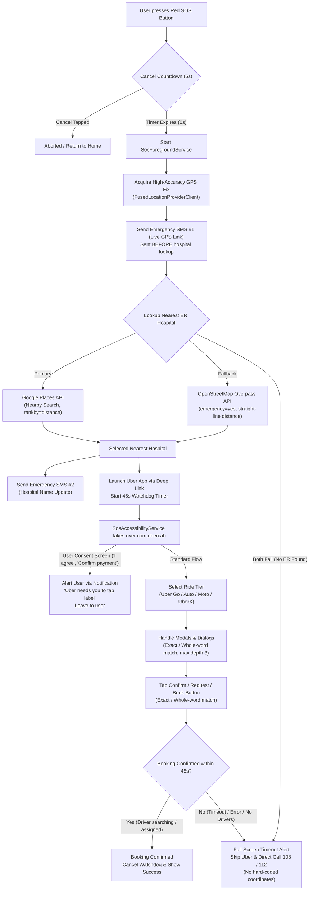

# SOS Ride

[](https://kotlinlang.org/)
[](https://developer.android.com/)
[](https://developer.android.com/jetpack/compose)

An autonomous emergency Android application that discovers the nearest emergency hospital, alerts emergency contacts with live tracking coordinates, and books an Uber ride with zero extra taps via an Accessibility Service.

> [!WARNING]
> **CRITICAL MEDICAL EMERGENCY NOTICE:** In a real emergency, call 108 (Ambulance) or 112 directly. Commercial rideshare vehicles are not equipped with medical equipment, oxygen, or trained paramedics, and are never an alternative to an Advanced Life Support (ALS) ambulance.

---

## Features

- **Large Red SOS Button**: High-contrast, tactile emergency button with a continuous pulsing glow animation on the Home Screen for rapid, panic-free activation. Proceeds with dispatch even if no emergency contacts are configured (with an on-screen warning and SMS skipped).
- **Visual Cancel Countdown**: Configurable 5-second countdown timer (`CANCEL_COUNTDOWN_SECONDS = 5`, set to `0` to disable) with a circular progress indicator and a prominent cancel button to undo accidental presses.
- **High-Accuracy Live Location**: Real-time GPS coordinate acquisition via Google Play Services `FusedLocationProviderClient` with high accuracy and a 12-second timeout, falling back to the device's last known location.
- **Nearest-Hospital Lookup with Dual Fallback**: Automatically discovers the closest hospital equipped with an emergency department using the Google Places API Nearby Search (`type=hospital`, `rankby=distance`, `keyword=emergency`). If the Google Places API key is missing or the request fails, it automatically falls back to the OpenStreetMap Overpass API (filtering strictly for `emergency=yes` up to 25 km and ranking candidates by straight-line distance). If neither provider finds an emergency facility, the app skips Uber dispatch without hard-coded coordinates and directly displays the 108/112 emergency calling screen.
- **Data Limitations Notice**: Hospital emergency filtering relies entirely on third-party map data (Places keyword matching and OpenStreetMap `emergency=yes` tags). It may miss actual emergency departments if map tagging is incomplete or outdated.
- **Uber Deep Link & Auto-Booking**: Instantly constructs and executes native Uber deep links (`uber://?action=setPickup&...`) pre-filling the user's pickup point and destination hospital. If the Uber app is absent, it falls back to the mobile web interface (`https://m.uber.com/ul/?...`).
- **Accessibility-Based UI Automation**: A custom `AccessibilityService` scoped strictly to `com.ubercab` detects the ride-selection screen, selects the cheapest or fastest available ride tier, clicks the booking confirmation button, handles intermediate modal dialogues (pickup pin, etc.), and stops when a driver match is detected.
- **Strict Keyword Matching & Ancestor Limits**: Uses exact full-label equality for single words ("ok", "done", "continue", "request", "book") and whole-word matching only for phrases of 2+ words. Traverses clickable ancestors up to 3 levels max, and never clicks any node with more than 3 children.
- **User Consent Screens**: Any Uber screens requiring user consent or payment verification (e.g., "I agree" policies, "Confirm payment") are intentionally left to the user. The app updates its ongoing notification with *"Uber needs you to tap \<label\>"* and lets the 45-second watchdog handle timeouts.
- **Sequential Emergency SMS**: Dispatches the initial emergency SMS containing the user's location link (`My location: https://maps.google.com/?q=LAT,LNG`) *before* hospital lookup begins, ensuring coordinates are received even if hospital discovery fails. Once a hospital is identified, a second short SMS is sent (`Nearest emergency hospital: <name>`). If the 45-second watchdog expires without confirmation, a third SMS is dispatched (`Ride could not be confirmed. Please call me or send help.`). If location lookup fails, the app alerts contacts with (`SOS - location unavailable, please call me`). Contact names only are logged, protecting phone numbers and message bodies.
- **Ambulance & Emergency Dialers (108 / 112)**: A persistent "CALL 108 AMBULANCE" bar is accessible across all screens. If an Uber booking is not confirmed within 45 seconds, the app triggers a full-screen emergency alert with direct buttons to dial 108 (Ambulance) or 112 (National Emergency).

---

## Screenshots

| Home Screen | 5s Countdown | Booking Progress | Timeout Alert (108/112) | Emergency Contacts |
|:---:|:---:|:---:|:---:|:---:|
|  |  |  |  |  |

*(Placeholder paths: store your screenshots under `/screenshots/`)*

---

## How It Works

### Step-by-Step Flow

1. **SOS Trigger**: The user taps the large red SOS button on the Home Screen. If no contacts are registered, a warning is shown but the emergency dispatch proceeds.
2. **Cancel Window**: A 5-second visual countdown begins (`CountdownScreen`), allowing the user to cancel in case of a false alarm.
3. **Foreground Service Engagement**: When the countdown reaches 0, `SosForegroundService` launches with an ongoing, high-priority notification to keep the process, network coroutines, and watchdog alive even when the app moves to the background.
4. **GPS Coordinate Acquisition**: `LocationRepository` queries `FusedLocationProviderClient.getCurrentLocation(Priority.PRIORITY_HIGH_ACCURACY)`.
5. **Initial Emergency SMS (Pre-Lookup)**: `SmsSender` immediately transmits the live GPS coordinates link (`https://maps.google.com/?q=LAT,LNG`) to saved contacts *before* hospital lookup begins. If no contacts are saved, this step is cleanly skipped.
6. **Hospital Discovery**: `HospitalRepository` queries Google Places Nearby Search for emergency hospitals. If Places returns an error or no results, it queries the OpenStreetMap Overpass API (filtering for `emergency=yes`) and ranks candidates by straight-line distance. If both fail to locate an emergency hospital, Uber dispatch is skipped entirely (with no hard-coded coordinates) and the 108/112 emergency calling screen is displayed.
7. **Hospital Follow-up SMS**: Once the nearest emergency hospital is confirmed, a second short SMS is sent to saved contacts with the hospital name.
8. **Uber Launch & Watchdog**: `UberDeepLinkManager` launches the Uber application pre-loaded with the pickup and hospital coordinates, and `SosStateManager` arms a 45-second confirmation watchdog timer.
9. **Accessibility Automation**:
   - `SosAccessibilityService` listens for window events from `com.ubercab`.
   - If screens requiring user consent or payment verification ("I agree", "Confirm payment") appear, the service does not auto-tap them. It alerts the user via notification: *"Uber needs you to tap \<label\>"*.
   - It searches for preferred ride tiers (`Uber Go`, `Auto`, `Moto`, `UberX`) and selects the first available.
   - It taps through non-sensitive intermediate confirmation modals (e.g., "Confirm pickup spot") using exact or whole-word matching, clicking at most 3 ancestor levels deep and never clicking container nodes with >3 children.
   - It locates and taps the primary booking button (`Confirm UberGo`, `Request`, `Book`).
10. **Booking Confirmation / Stop**: Once the screen displays confirmation cues ("Finding your ride", "Connecting to a driver", "Driver is on the way", or "Cancel ride"), the service registers success, cancels the watchdog, and transitions to the confirmed state.
11. **Timeout Fallback**: If 45 seconds elapse without booking confirmation (no drivers, payment issue, UI change, or no internet), `SosStateManager` interrupts the flow and presents `TimeoutAlertScreen`, prompting the user to call 108 or 112 immediately.

### Flowchart



---

## Tech Stack

- **Language**: Kotlin 1.9.23
- **UI Framework**: Jetpack Compose (Compose BOM 2024.06.00, Material 3)
- **Minimum SDK**: Android 8.0 (API Level 26 / minSdk 26)
- **Target / Compile SDK**: Android 14 (API Level 34)
- **Location**: Google Play Services Location (`play-services-location:21.3.0`, `kotlinx-coroutines-play-services:1.8.1`)
- **Networking**: OkHttp 4.12.0
- **Serialization**: `kotlinx.serialization` 1.6.3 & native `org.json`
- **Concurrency & State**: Kotlin Coroutines 1.8.1 & `StateFlow`
- **Android System Services**:
  - `AccessibilityService` (scoped to `com.ubercab` via `accessibility_service_config.xml`)
  - `ForegroundService` (with `foregroundServiceType="location"`)
  - `SmsManager` (multi-part SMS dispatch)
  - `Intent.ACTION_CALL` (direct 108 dialing with runtime permission)

---

## Requirements

1. **Android Version**: Android 8.0 (Oreo, API level 26) or higher.
2. **Physical Device**: Must be installed on a real physical Android smartphone. Emulators can't send real SMS or make real calls.
3. **Active Telephony**: An active SIM card with cellular SMS balance and voice calling capabilities.
4. **Uber Application**: The official Uber app (`com.ubercab`) must be installed, logged into an active account, and configured with a saved default payment method (credit card, digital wallet, or cash profile) so bookings proceed without manual billing prompts.

---

## Setup and Installation

### 1. Clone the Repository
```bash
git clone <repository-url>
cd sos-ride
```

### 2. Configure the Google Places API Key
Open or create `sos-ride/local.properties` and add your Google Places API Key:
```properties
PLACES_API_KEY=AIzaSyYourActualGooglePlacesApiKeyHere
```
> **Note**: If `PLACES_API_KEY` is not provided or remains empty, the app will automatically fall back to the OpenStreetMap Overpass API without breaking the emergency flow.

### 3. Build the Application
Open the `sos-ride` folder in **Android Studio** (Hedgehog / Iguana / Jellyfish or newer) and let Gradle sync, or build via the command line:
```bash
# On Windows
gradlew.bat assembleDebug

# On Linux / macOS
./gradlew assembleDebug
```
The output APK will be generated at `app/build/outputs/apk/debug/app-debug.apk`.

### 4. Install and Grant Permissions
Install the APK onto your connected physical device:
```bash
adb install -r app/build/outputs/apk/debug/app-debug.apk
```
Launch the app. On first launch, tap **"Grant Required Permissions"** to approve Location, SMS, and Phone Call permissions.

### 5. Enable the Accessibility Service
To allow the automated booking service to interact with Uber:
1. Tap the warning card on the Home Screen or navigate to:  
   **Settings > Accessibility > Downloaded Apps > SOS Ride Uber Automation**
2. Toggle the switch to **ON**.
3. Accept the Android system confirmation prompt granting permission to inspect window content and perform click actions.

> [!IMPORTANT]
> **Android 13+ Restricted Settings Note**: On Android 13 and newer, sideloaded APKs have Accessibility toggles disabled under restricted settings.  
> To resolve this:
> 1. Go to **Settings > Apps > SOS Ride**.
> 2. Tap the **three-dot menu** in the top right corner.
> 3. Select **Allow restricted settings**.
> 4. Authenticate (PIN/fingerprint), then return to **Accessibility** and turn the service ON.

### 6. Configure Emergency Contacts
The app starts with an **empty** emergency contacts list. If no contacts are added, the emergency ride will still proceed, but SMS alerts will be skipped:
1. Tap the **Settings** gear icon in the top right of the Home Screen.
2. Tap **Add Emergency Contact** to enter 1–3 trusted family or caregiver phone numbers (with country code, e.g. `+919876543210`).

---

## Permissions Table

| Permission | Purpose |
| :--- | :--- |
| `android.permission.ACCESS_FINE_LOCATION` | Obtains precise GPS coordinates to find the nearest emergency hospital and set the Uber pickup point. |
| `android.permission.ACCESS_COARSE_LOCATION` | Provides network-based location fallback if GPS satellite lock is delayed. |
| `android.permission.SEND_SMS` | Dispatches emergency SMS messages containing the live Google Maps pin link to saved contacts. |
| `android.permission.CALL_PHONE` | Enables direct one-tap dialing to the 108 Ambulance helpline without navigating away to the phone dialer. |
| `android.permission.INTERNET` | Queries the Google Places API, OpenStreetMap Overpass API, and executes Uber web fallback links. |
| `android.permission.ACCESS_NETWORK_STATE` | Validates active network connectivity before dispatching network requests. |
| `android.permission.FOREGROUND_SERVICE` | Keeps the application and watchdog process alive when the Uber app is opened over it. |
| `android.permission.FOREGROUND_SERVICE_LOCATION` | Required on Android 14+ (API 34) for foreground services accessing location in the background. |
| `android.permission.POST_NOTIFICATIONS` | Displays the persistent emergency ongoing notification with quick "Call 108" and "Cancel" actions on Android 13+. |

> [!NOTE]
> **Accessibility Service Authorization**: Unlike runtime permissions that prompt via dialog boxes, the Accessibility Service is a privileged Android subsystem. It is declared in `AndroidManifest.xml` with `android:permission="android.permission.BIND_ACCESSIBILITY_SERVICE"` and must be explicitly enabled by the user in Android Settings under **Accessibility > Downloaded Apps > SOS Ride Uber Automation**.

---

## Testing Safely

When testing the app to verify automation and end-to-end flows:
1. **Emergency Contact Setup**: During testing, set **your own phone number** as the only emergency contact so family members are not alarmed by automated emergency SMS dispatches.
2. **Cancel Countdown Testing**: Practice pressing the SOS button and tapping **"CANCEL SOS (FALSE ALARM)"** during the 5-second countdown to verify cancellation without triggering dispatch.
3. **Cancelling Test Rides Immediately**: Auto-booked Uber rides cost real money. If testing with a real Uber account, keep your eyes on the Uber screen and **cancel the test ride immediately in the Uber app** once booked to prevent driver dispatch and avoid cancellation fees.

---

## Configuration

All core operational variables are centralized and can be edited in source code:

| Setting | Full File Path | Variable / Constant | Default Value | Description |
| :--- | :--- | :--- | :--- | :--- |
| **Cancel Countdown** | `app/src/main/java/com/sosride/app/state/SosStateManager.kt` | `CANCEL_COUNTDOWN_SECONDS` | `5` | Countdown in seconds before dispatch begins. Set to `0` to disable the countdown entirely. |
| **Watchdog Timeout** | `app/src/main/java/com/sosride/app/state/SosStateManager.kt` | `WATCHDOG_TIMEOUT_SECONDS` | `45` | Maximum seconds allowed for Uber booking confirmation before showing the 108/112 alert screen. |
| **Action Cooldown** | `app/src/main/java/com/sosride/app/service/SosAccessibilityService.kt` | `ACTION_COOLDOWN_MS` | `900L` | Debounce delay between automated taps to prevent duplicate clicks while screens animate. |
| **GPS Fix Timeout** | `app/src/main/java/com/sosride/app/data/repository/LocationRepository.kt` | `LOCATION_TIMEOUT_MS` | `12000L` | Maximum time to wait for a fresh high-accuracy GPS fix before falling back to last known location. |
| **Emergency Contacts** | `app/src/main/java/com/sosride/app/data/repository/ContactRepository.kt` | `KEY_CONTACTS` | Empty list | Managed in-app via **Settings (Gear Icon) > Emergency Contacts**. Starts empty; SMS is skipped if empty. |
| **Uber Button Keywords** | `app/src/main/java/com/sosride/app/service/SosAccessibilityService.kt` | `PRIMARY_CONFIRM_BUTTON_KEYWORDS` | List of button labels | Text and content description strings used to find and tap Uber's confirm and request buttons via exact/whole-word matching. |
| **Intermediate Modals** | `app/src/main/java/com/sosride/app/service/SosAccessibilityService.kt` | `INTERMEDIATE_MODAL_KEYWORDS` | List of dialog labels | Keywords for pickup pin verification, payment selection, and safety dialog dismissal via exact/whole-word matching. |
| **User Action Modals** | `app/src/main/java/com/sosride/app/service/SosAccessibilityService.kt` | `USER_CONSENT_OR_PAYMENT_KEYWORDS` | `"i agree"`, `"confirm payment"`, `"accept higher fare"`, `"pay with cash"`, `"select payment"`, `"personal profile"` | Keywords requiring explicit user consent or payment verification; triggers a high-importance vibration notification and leaves action to user. |
| **Ride Tier Priorities** | `app/src/main/java/com/sosride/app/service/SosAccessibilityService.kt` | `PREFERRED_RIDE_TIER_KEYWORDS` | `ubergo`, `auto`, `moto`, etc. | Priority order of ride options to select on the Uber vehicle selection screen. |

---

## Project Structure

```
sos-ride/
├── build.gradle.kts                                    # Root Gradle build script defining Android & Kotlin plugins
├── settings.gradle.kts                                 # Project settings and plugin repository declarations
├── gradle.properties                                   # JVM memory allocations and AndroidX properties
├── local.properties                                    # Local SDK paths and Google Places API key (not in VCS)
├── gradlew / gradlew.bat                               # Gradle wrapper execution scripts for Unix and Windows
├── screenshots/                                        # Directory containing application interface screenshots
├── app/
│   ├── build.gradle.kts                                # Module build file: dependencies, SDK versions, and BuildConfig injection
│   ├── proguard-rules.pro                              # Proguard rules for reflection and Kotlinx serialization
│   └── src/
│       ├── test/java/com/sosride/app/
│       │   ├── UberDeepLinkTest.kt                     # Unit tests validating deep link URI formats and parameters
│       │   └── MatchesKeywordTest.kt                   # Unit tests validating exact and whole-word keyword matching rules
│       └── main/
│           ├── AndroidManifest.xml                     # App manifest declaring permissions, services, and queries
│           ├── res/
│           │   ├── xml/
│           │   │   ├── accessibility_service_config.xml # Accessibility configuration scoped to com.ubercab
│           │   │   ├── data_extraction_rules.xml       # Android 12+ backup extraction security configuration
│           │   │   └── backup_rules.xml                # Legacy cloud backup rules
│           │   ├── values/
│           │   │   ├── strings.xml                     # Localized string definitions and service descriptions
│           │   │   ├── colors.xml                      # Emergency theme color definitions
│           │   └── themes.xml                          # System window and navigation bar styling
│           │   ├── drawable/
│           │   │   ├── ic_launcher_background.xml      # Vector launcher background
│           │   │   └── ic_launcher_foreground.xml      # Vector medical cross launcher foreground
│           │   └── mipmap-anydpi-v26/                  # Adaptive application icons
│           └── java/com/sosride/app/
│               ├── SosApplication.kt                   # Application singleton instance provider
│               ├── MainActivity.kt                     # Root Activity managing permissions and Compose screen transitions
│               ├── data/
│               │   ├── model/
│               │   │   ├── Hospital.kt                 # Data model for hospital metadata, distance, and coordinates
│               │   │   ├── EmergencyContact.kt         # Data model for emergency contact name and phone number
│               │   │   └── SosState.kt                 # State definitions (SosPhase and SosUiState)
│               │   ├── api/
│               │   │   ├── GooglePlacesService.kt      # Google Places API Nearby Search client
│               │   │   └── OverpassService.kt          # OpenStreetMap Overpass emergency hospital fallback client
│               │   └── repository/
│               │       ├── LocationRepository.kt       # FusedLocationProviderClient manager for high-accuracy GPS
│               │       ├── HospitalRepository.kt       # Orchestrator resolving closest hospital via Places or Overpass
│               │       └── ContactRepository.kt        # SharedPreferences persistence for emergency contacts
│               ├── service/
│               │   ├── SosAccessibilityService.kt      # Accessibility engine that scans and clicks Uber UI components
│               │   ├── SosForegroundService.kt         # Foreground service maintaining SOS state and notification
│               │   ├── SmsSender.kt                    # SmsManager wrapper handling multi-part emergency text alerts
│               │   └── UberDeepLinkManager.kt          # Deep link constructor and Uber package launcher
│               ├── state/
│               │   └── SosStateManager.kt              # Central StateFlow repository managing watchdog and phases
│               ├── ui/
│               │   ├── theme/
│               │   │   ├── Color.kt                    # Material 3 dark emergency palette
│               │   │   ├── Type.kt                     # Typography configuration
│               │   │   └── Theme.kt                    # Compose theme and status bar integration
│               │   ├── components/
│               │   │   ├── BigRedSosButton.kt          # Animated pulsing red SOS emergency button component
│               │   │   └── CallAmbulanceBar.kt         # Persistent "CALL 108 AMBULANCE" action bar component
│               │   ├── screens/
│               │   │   ├── OnboardingPermissionsScreen.kt # Permissions explainer and accessibility activation guide
│               │   │   ├── HomeScreen.kt               # Primary dashboard with SOS button and status indicators
│               │   │   ├── CountdownScreen.kt          # 5-second cancel countdown screen
│               │   │   ├── BookingProgressScreen.kt    # Step-by-step dispatch and automation monitoring screen
│               │   │   ├── TimeoutAlertScreen.kt       # Full-screen 45-second watchdog alert with 108/112 dialers
│               │   │   └── SettingsContactsScreen.kt   # Emergency contacts configuration and SMS preview screen
│               │   └── viewmodel/
│               │       └── SosViewModel.kt             # UI state bridge and call/SMS dispatcher
│               └── util/
│                   ├── PermissionUtils.kt              # Utilities for runtime permissions and accessibility status
│                   └── NetworkUtils.kt                 # Active network connectivity checker
```

---

## Troubleshooting

### 1. Uber Button Not Tapped
- **Cause**: Uber has changed its button text or structure in your region, your phone language is set to a non-English locale, or the screen requires user consent.
- **Fix**: Check `adb logcat -s SosAccessibilityService`. Inspect the detected view hierarchy text. If the notification states *"Uber needs you to tap \<label\>"*, tap that button manually. Add any new non-consent button labels to `PRIMARY_CONFIRM_BUTTON_KEYWORDS` or `INTERMEDIATE_MODAL_KEYWORDS` in `app/src/main/java/com/sosride/app/service/SosAccessibilityService.kt`.

### 2. Location Not Found
- **Cause**: Device location/GPS is toggled off, or the device is indoors without satellite visibility.
- **Fix**: Ensure Location (GPS) is turned ON in Android Quick Settings. The app will wait up to 12 seconds for a fresh high-accuracy fix before falling back to your last known location.

### 3. Accessibility Service Not Enabled / Greyed Out / Stops Working
- **Cause 1**: On Android 13+, sideloaded APKs have Accessibility toggles disabled under restricted settings.
  - **Fix**: Go to **Settings > Apps > SOS Ride > Three-dot menu > Allow restricted settings**. Then re-enable the toggle in Accessibility settings.
- **Cause 2**: Some Android OEMs (such as Xiaomi/MIUI, Samsung, or OnePlus) aggressively kill background accessibility services to conserve battery.
  - **Fix**: Re-enable the service under **Settings > Accessibility > SOS Ride Uber Automation**. Lock the app in the recent apps overview and exempt SOS Ride from battery optimization under **Settings > Apps > SOS Ride > Battery > Unrestricted**.

### 4. No Drivers Available / Surge Pricing / Cost Warning
- **Cause**: Uber shows "No cars available" or displays an interactive surge pricing confirmation modal.
- **Fix**: If Uber cannot confirm the ride within 45 seconds, the watchdog will automatically display `TimeoutAlertScreen`. Tap **"CALL 108 (AMBULANCE)"** or **"CALL 112"** immediately. Remember that auto-booked rides cost real money and Uber's cancellation fee policies apply if a trip is cancelled after dispatch.

### 5. API Errors (Google Places Fails)
- **Cause**: Missing, invalid, or unbilled Google Places API Key.
- **Fix**: The app is designed to fail gracefully. If Google Places fails, it immediately logs a warning and queries the OpenStreetMap Overpass API without stopping the flow. If neither provider returns an emergency hospital, Uber dispatch is skipped (with no hard-coded coordinates) and the 108/112 dialer is immediately shown.

---

## Platform Comparison

| Capability | Android Native & React Native (Android) | iOS (iPhone / iPad) |
| :--- | :--- | :--- |
| **SOS Trigger** | One-tap on large red SOS button | One-tap on large red SOS button |
| **Cancel Window** | 5-second countdown with visual Cancel button | 5-second countdown with visual Cancel button |
| **Location Discovery** | High-accuracy GPS (12s timeout, fallback to last known) | High-accuracy GPS via CoreLocation (12s timeout) |
| **Emergency SMS** | Dispatched before hospital lookup; third SMS on watchdog timeout | Opens pre-filled SMS composer (user taps Send); fallback to Share sheet |
| **Hospital Discovery** | Google Places + OSM Overpass (ranked by straight-line distance) | Google Places + OSM Overpass (ranked by straight-line distance) |
| **Uber Integration** | Direct `uber://` deep link execution | Direct `uber://` deep link execution (no App Store bounce) |
| **Ride Booking** | **Auto-books** via AccessibilityService (detects ride tier & taps Confirm) | **One-tap Confirm**: Apple sandbox prevents UI auto-tap; pre-fills pickup & ER dropoff, user taps Confirm in Uber |
| **Consent & Payment** | Heads-up vibration alert: *"Uber needs you to tap \<label\>"* | Handled directly by user in Uber interface |
| **Watchdog Timeout** | 45-second timer displays 108/112 alert screen | 45-second timer displays 108/112 alert screen |

---

## Limitations and Disclaimer

1. **Platform Differences (Android vs. iOS)**: iOS security architecture and sandbox policies strictly prevent third-party applications from simulating touch events or auto-tapping other apps. While Android automatically selects the ride tier and confirms booking via an Accessibility Service, iOS users must perform one manual tap on "Confirm" in the pre-filled Uber screen.
2. **Third-Party UI Dependency**: The Android automation relies on Android's Accessibility framework to inspect and interact with the Uber user interface. Any significant update to Uber's layout, button phrasing, or view tree can interrupt the automated booking flow. Users must remain attentive and be prepared to complete the booking manually or use emergency calling.
3. **Not Intended for Google Play Store Distribution**: Google Play Developer Policies strictly prohibit the use of the `AccessibilityService` API for automating third-party applications or interacting with apps outside of authorized accessibility and disability-assistive contexts. Apps utilizing accessibility services for ride automation will be rejected or suspended from the Play Store.
4. **Terms of Service**: Automating interactions within the Uber client application may conflict with Uber's Terms of Service and acceptable use policies regarding automated interface interaction.
5. **Hospital Data & Emergency Detection**: Hospital distance is ranked using straight-line (great-circle) distance. Emergency department discovery relies entirely on third-party map data (Google Places keyword matching and OpenStreetMap `emergency=yes` tags) and may fail to identify real emergency rooms if map metadata is missing or outdated.
6. **User Incapacitation & Consent Modals**: Uber interfaces that prompt for terms agreement (e.g., "I agree") or payment method confirmation are intentionally not auto-tapped. If the user is incapacitated or unable to interact with their screen, these consent screens will stall the automated booking until the 45-second watchdog expires and displays the 108/112 emergency calling screen.
7. **Rides Cost Money & Cancellation Fees**: Auto-booked rides incur real charges to the user's saved payment method. Uber's cancellation fee policies apply if a trip is cancelled after driver assignment.
8. **Helpline Number Defaults**: The default emergency numbers embedded in the app (108 for Ambulance and 112 for National Emergency) are **India-specific defaults**. Users deploying in other countries must adjust the dialer configuration (e.g. to `911` for the US or `999` for the UK).
9. **Medical Emergency Disclaimer**: SOS Ride is an auxiliary tool and **not** a licensed emergency medical dispatch system. Commercial rideshares are not equipped with medical equipment, oxygen, or trained paramedics. In life-threatening emergencies (e.g., severe hemorrhage, chest pain, cardiac arrest, difficulty breathing, or stroke), **always dial official emergency medical services (108 in India, 911 in the US, or 112 in the EU) immediately**.

---

## Privacy

- **Location Data**: Precise GPS coordinates are acquired solely during an active SOS event and are transmitted only to mapping APIs (Google Places, OpenStreetMap Overpass, and Apple Maps) to locate nearby emergency facilities and populate Uber pickup coordinates. Location data is never sold, shared with advertisers, or tracked when SOS is idle.
- **Emergency Contacts**: Emergency contacts are stored locally on the user's physical device in local storage / SharedPreferences and start completely empty. Contacts are never uploaded to remote tracking databases.
- **SMS Privacy**: Phone numbers and SMS message bodies are strictly omitted from application logs. Only contact display names are logged. Standard mobile carrier SMS charges may apply.

---

## Manual Test Checklist

Use this physical testing checklist to verify the SOS Ride flow safely:

1. **Pre-requisites**:
   - Ensure the official Uber application is installed, logged in, and has an active payment method saved.
   - Configure **your own phone number** as the only emergency contact to avoid alarming family members during testing.
2. **Cancel During Countdown**:
   - Press the SOS button on the home screen.
   - During the 5-second countdown, tap **"CANCEL SOS (FALSE ALARM)"**.
   - **Verification**: The countdown aborts immediately; no GPS lock or SMS is sent, and Uber is never launched.
3. **End-to-End Ride Dispatch**:
   - Press SOS and allow the 5-second countdown to complete.
   - **Verification**:
     - Android: The initial SMS is sent to your number with your live location pin (`https://maps.google.com/?q=...`).
     - iOS: The SMS composer opens pre-filled with the location link for one-tap sending.
     - The nearest emergency hospital is located and a second SMS update is dispatched with the hospital name.
     - The Uber application opens directly with your current location as pickup and the hospital pre-filled as drop-off (with zero App Store redirects).
4. **Booking Confirmation**:
   - **Android**: The Accessibility Service selects the preferred ride tier and requests the ride without manual taps. If a consent or surge modal appears, verify that a high-importance notification alerts you: *"Uber needs you to tap \<label\>"*.
   - **iOS**: Verify the screen displays *"Uber opened. Tap Confirm in Uber to book."* Tap "Confirm" once in Uber.
5. **Immediate Cancellation**:
   - Cancel the test ride immediately inside the Uber app once confirmed to prevent driver dispatch and avoid cancellation fees.
6. **Network & Location Failure (Airplane Mode)**:
   - Enable Airplane Mode on the device and press SOS.
   - **Verification**: The 108/112 emergency calling screen appears immediately; Uber does NOT open and no hard-coded coordinates are used.
7. **Empty Contacts Test**:
   - Delete all emergency contacts from Settings and trigger SOS.
   - **Verification**: A warning card is displayed stating SMS alerts will be skipped, but the emergency ride dispatch to the nearest hospital proceeds uninterrupted.

---

## License & Author

- **License**: MIT License. See [LICENSE](LICENSE) for details.
- **Author**: SOS Ride Team (Google Antigravity & Pair Programming)
- **Disclaimer**: Developed strictly for research, rapid medical accessibility experimentation, and educational demonstration of Android Accessibility Automation.
