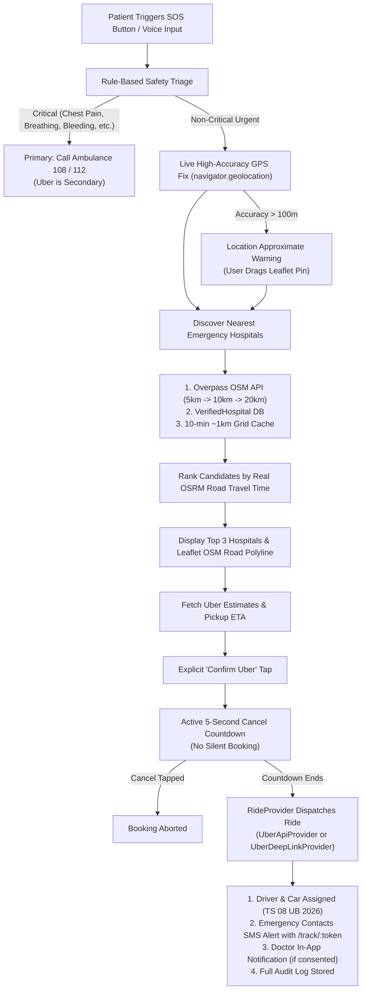

# SOS Emergency → Uber to Nearest Emergency Hospital (BookDoctor)

## Overview
BookDoctor's SOS Emergency module connects patients in urgent medical distress to the nearest emergency hospital using **OpenStreetMap (Overpass API + OSRM Routing)** and dispatches an **Uber ride** directly to the hospital's Emergency Department.

---

## Architecture & Flow Diagram



---

## Non-Negotiable Safety Rules Enforced

1. **Always-Visible Ambulance Helpline**:
   - The primary header of every SOS screen contains a direct `tel:108` emergency dialer.
   - Standard disclaimer: *"A cab is not suitable for life-threatening emergencies. In a critical emergency call 108/112."*
2. **Rule-Based Triage (Zero AI Override)**:
   - Evaluates: chest pain, breathing difficulty, severe bleeding, loss of consciousness, stroke signs, severe trauma.
   - If ANY symptom is checked, Ambulance 108 is the primary prominent action; Uber is strictly secondary.
   - AI/Voice input is restricted strictly to text transcription assistance.
3. **Explicit Confirmation & 5-Second Cancel Countdown**:
   - No ride is ever booked autonomously or silently.
   - Tap on "Confirm Uber" initiates an active 5-second countdown with an audible/visual cancel button.
4. **Privacy & Minimal Data Exposure**:
   - Patient GPS is rounded to ~1 km when shared with doctors.
   - Public tracking link (`/track/:token`) expires after 6 hours and exposes zero medical history or diagnoses.
   - OAuth tokens are encrypted at rest using authenticated AES-256-GCM.
5. **No Google Maps Dependency**:
   - Map rendering: **Leaflet + OpenStreetMap tiles**.
   - Hospital search: **OpenStreetMap Overpass API + MongoDB VerifiedHospital collection**.
   - Road route & ETA matrix: **OSRM (Open Source Routing Machine)**.

---

## Setup & Uber Developer Configuration

### 1. Register Uber Developer App
1. Navigate to the [Uber Developer Dashboard](https://developer.uber.com/dashboard).
2. Create an application with **Rides API** enabled.
3. In App Settings:
   - Add Redirect URI: `http://localhost:5000/api/uber/oauth/callback` (or your production backend domain).
   - Enable Scopes: `request` (Ride Requests), `profile`, `history`.
4. Copy `Client ID` and `Client Secret` to your backend `.env`.

### 2. Uber Sandbox Mode
In development, set `UBER_SANDBOX=true`.
- The sandbox simulates instant driver matching, ETA calculation, and ride progression.
- Test ride state transitions can be triggered using sandbox PUT requests without credit card charges.

### 3. Environment Variables (`server/.env`)
```bash
# Uber Configuration
UBER_CLIENT_ID=your_uber_client_id
UBER_CLIENT_SECRET=your_uber_client_secret
UBER_REDIRECT_URI=http://localhost:5000/api/uber/oauth/callback
UBER_SANDBOX=true
UBER_RIDE_PROVIDER=uber_api  # or uber_deep_link
ENCRYPTION_SECRET=bookdoctor_aes256_emergency_secret_key_32_bytes!

# OpenStreetMap & OSRM Routing
OSRM_BASE_URL=https://router.project-osrm.org
OVERPASS_URL=https://overpass-api.de/api/interpreter

# Twilio SMS (Emergency Dispatch Alerts)
TWILIO_ACCOUNT_SID=your_twilio_sid
TWILIO_AUTH_TOKEN=your_twilio_auth_token
TWILIO_PHONE_NUMBER=+1234567890
EMERGENCY_PHONE_NUMBER=+919876543210
```

---

## Known Limitations & Mitigation

| Limitation | Impact | Mitigation Implemented |
| :--- | :--- | :--- |
| **Regional Uber API Restrictions** | Uber Ride Request API approval is restricted in certain jurisdictions. | Automatic fallback to `UberDeepLinkProvider` which opens pre-filled universal deep links in the Uber app with exact pickup and hospital coordinates. |
| **Public OSRM Demo Server Limits** | `router.project-osrm.org` has public demo rate limits. | Configurable `OSRM_BASE_URL` env variable for self-hosted instances + fallback to Haversine driving duration estimates (~30 km/h). |
| **Overpass API Timeouts** | Peak hours can cause public Overpass API latency. | 1. 10-minute in-memory caching per ~1 km grid.<br>2. Multiple backup endpoints.<br>3. Instant fallback to `VerifiedHospital` MongoDB seed collection. |
| **Poor Mobile Connectivity** | GPS signal degradation in dense concrete structures. | High accuracy mode with 10s timeout, fallback to last known location, and draggable pin on Leaflet map. |
